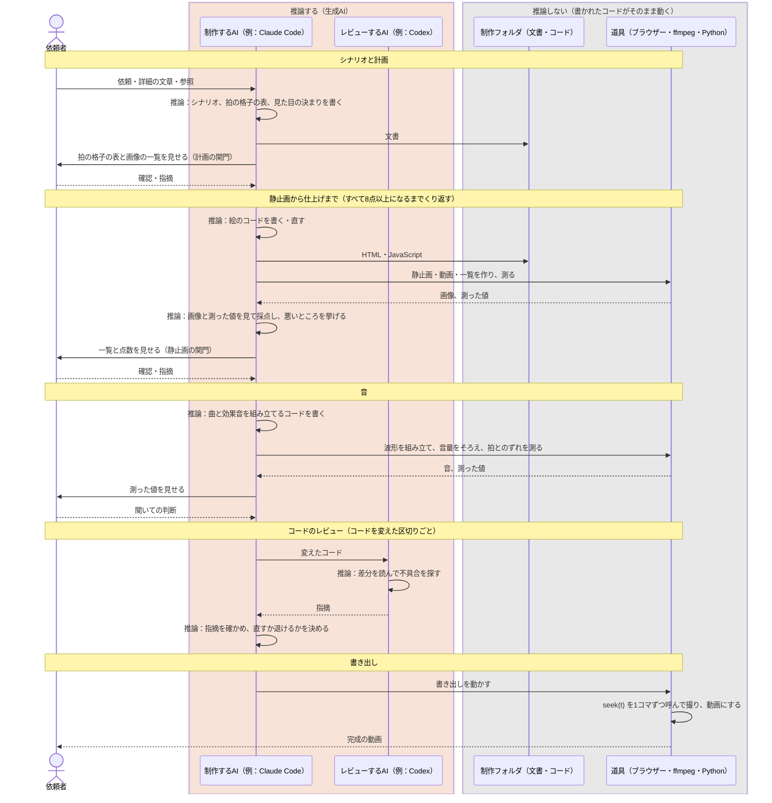

# コードで描くモーショングラフィックス動画の制作ガイドライン

HTMLとJavaScriptで時刻ごとの画面を描き、ヘッドレスブラウザーで1コマずつ撮って動画にする作り方の指針です。人が生成AI（Claude Codeなど）に、製品や取り組みを紹介する短い動画を作らせるときに使います。

1分の紹介動画を3版作った経験（11章）から得た知見をまとめたものです。規約ではなくガイドラインとし、数値はその動画で確かめた目安として扱います。今後の制作で分かったことに合わせて改めます。

## 1. 位置付けと適用範囲

- 対象は、1〜2分程度の製品・取り組みの紹介動画を、コードで描いて作る作業です。一般にモーショングラフィックス（motion graphics、MG）と呼ばれ、種類としては解説・紹介動画（explainer）にあたります。勢いのある紹介映像は、sizzle videoとも呼ばれます。
- 実写の編集、ナレーションが主の動画、長い講座の動画は対象外です。ただし、3章（進め方と確かめ方）、4章（描き方）、7章（書き出し）はそのまま使えます。
- 対象プロジェクトの制作フォルダには、指示書（`CLAUDE.md`・`AGENTS.md`）を置き、その動画の色・書体・拍の格子・見せてよい画面を書きます。指示書から本書を参照します。対象プロジェクトの指示と依頼者の個別の依頼を、本書より優先します。

## 2. 品質を決めるもの

1本目（第1版）は依頼者に「まだチープ」と評され、第2版で品質が大きく上がりました。比べる実験はしていませんが、変わったところごとに出どころを対応させると、効いた順は次のとおりです。

1. **何を見せるかの具体的な指示**：場面ごとの依頼者の指摘が最も効きました。例えば、困りごとの場面を暗い地にし、解決の場面から明るい地にする、どの画面を大きく見せる、といった指摘です。
2. **縛りを早めに確かめる**：第1版の安っぽさの多くは、生成AIが資料を解釈して自分に課した縛りから来ていました（「製品の画面は公式の画像だけ」「白い地」「太く大きい文字」）。依頼者の必須の条件か、AIの解釈かを、計画の関門で確かめます。
3. **描いては確かめる道具と関門**：静止画・下書き・検査の道具で確かめる回数を増やすほど、品質が上がります。速く書き出せることも品質につながります。
4. **見せ方の技法と参照**：技法のSkill、見た目のカタログ、参照の動画は、1〜3の後に効きます。カタログを入れるだけでは、1と2は埋まりません。

## 3. 進め方と確かめ方

### 3.1. 最初の依頼と指示書

生成AIへの最初の依頼には、次のことを書きます。

- 役割（例：「腕のいいモーションデザイナー」）と、動画の一行（見た人に残したいこと）
- 見る人と見る場所（例：社内のSNSのフィードで、音を出さずに見る人が多い）
- 形式（比率・解像度・fps・長さ）と、最後の画面を最初の画面につなぐか
- 拍の構成・見た目・音を書いたシナリオの場所
- 参照（ブランドの資料、参照の画像・動画）と、そこから取るもの・取らないもの
- 製品の画面をどこまで描き直してよいか（5.2）
- 進め方（3.2の関門）と、納品するもの（完成の動画、ポスター画像、一覧、制作の手順）

制作フォルダの指示書には、描き方の決まり（4章）、書き出しの手順、色・書体・強調の色、使わない見た目（5.4）、音の目安（8章）、見せる前の確認（3.3）、関門を置きます。

### 3.2. 関門

計画 → 静止画 → 動きの下書き → 全体 → 仕上げ → 音 → 書き出し の順に進めます。計画と静止画は、依頼者の確認を得てから次へ進みます。

| 関門 | 見せるもの |
| --- | --- |
| 計画 | 拍の格子の表（拍ごとの時刻・出来事・文字・使う画像）と、使う画像の一覧 |
| 静止画 | 拍ごとの静止画を並べた一覧（コンタクトシート）と、スマホの幅で見る一覧。あわせて動きの下書き |
| 動きの下書き | 低い解像度の動画（例：960×540・30fps・音なし）。仕上げへ進む前に見せる |
| 完成 | 完成の動画、1秒ごとの一覧、場面の変わり目の前後のコマ |

- 静止画だけでは、動きの質を判断できません。静止画の関門で動きの下書きも一緒に見せると、話が早く進みます。
- 拍の格子：BPMを決め（例：120。1拍0.5秒、1小節2秒）、状態の変わり目を拍の頭に、大きな変わり目を小節の頭に置きます。映像と音を同じ格子にそろえます。

### 3.3. 採点と直し方

- 次の7項目を1〜10点で採点し、すべて8点以上になるまで繰り返します：最初の2秒のつかみ、スマホの幅での読みやすさ、動きの質、変化の多さ、構図、ブランドの正確さ、音と拍の合い方。静止画の関門では、動きの質と音と拍の合い方は採点しません。
- 厳しい監督として、悪いところを3つ、時刻つきで挙げて直します。直した秒だけ書き出し直し、新しい一覧と点数を見せます。
- 点数と直したことを、制作フォルダの記録（例：`docs/review.md`）に残します。直さないことも、理由をつけて残します。

### 3.4. 確かめる道具

| 道具 | 確かめること |
| --- | --- |
| 拍ごとの静止画と一覧 | 構図、はみ出し、重なり |
| スマホの幅（360px）の一覧 | 文字が読めるか |
| 変わり目の前後のコマ（例：前後12コマ） | つなぎで箱が跳ばないか、濁った色が出ないか |
| 決定性の確認 | 同じ時刻を別のページで、描く順を変えて2回描き、同じ絵になるか（4.3） |
| 読む時間の検査 | 文が読み切れるだけの時間、出ているか（6章） |
| 重なりの検査 | 飾り（波など）が文字・ロゴに重ならないか。静止画ではなく、区間の全コマで測る |
| 別の生成AIのコードレビュー | 時刻を戻すと絵が変わる、つなぎで箱が跳ぶ、ffmpegの失敗を成功とみなす、など目で見落とす不具合 |

書き出した動画から一覧を作るとき、ffmpegの `fps` フィルターで間引くと、取るコマの時刻が表示とずれることがあります（今回は約0.5秒）。整数の秒のコマを `select` で選び、表示する時刻と実際のコマを合わせます。

### 3.5. 生成AIの推論が走るところ

この作り方では、生成AIが動画そのものを作ることはありません。生成AIは、動画を描くコードと、その元になる文書を書きます。そして、出来を画像と数値で確かめて直します。推論が走るのは次の表の上の4つで、書き出し・音の組み立て・確かめる道具では走りません。

| 処理 | 推論 | 受け取るもの | 出すもの |
| --- | --- | --- | --- |
| シナリオ・計画を書く | 走る（制作するAI） | 依頼、詳細の文章、参照の画像、依頼者の答え | シナリオ、拍の格子の表、見た目の決まり |
| コードを書く・直す | 走る（制作するAI） | 文書、今のコード、採点の結果、依頼者の指摘 | 絵・音・確かめる道具のコード |
| 採点する | 走る（制作するAI） | 静止画・一覧の画像、測った値 | 点数と悪いところ（3.3） |
| コードをレビューする | 走る（別の生成AI） | コードの差分 | 指摘 |
| 書き出し（`seek(t)` を呼んで撮る） | 走らない | HTML、時刻 | 動画 |
| 音の組み立て・音量の調整 | 走らない | 楽器・効果音の音 | 音、測った値 |
| 確かめる道具 | 走らない | HTML、動画、音 | 画像、測った値 |



- 推論の結果は、いつも文書とコードとして制作フォルダに残ります。同じコードからは何度書き出しても同じ動画になり、前の版にもGitで戻せます。動画を直すときは、コードを直して書き出し直します。
- 推論が受け取れるのは、文字・画像・数値です。動きは動画のままでは渡せないので、変わり目の前後のコマを並べた画像や、測った値に変える道具（3.4）を用意します。音は測った値（音量・拍とのずれ）までしか確かめられないので、良し悪しは依頼者が聞いて決めます（8章）。
- 書き出しの時間は、推論ではなく、ブラウザーとffmpegにかかります（7章）。書き出しそのものは推論を使わないので、何度やり直しても推論の費用は増えません。

## 4. 描き方（毎回同じ絵にする）

### 4.1. 時刻だけで描く

- 1つのHTMLファイルに `window.seek(t)` を作り、すべての画面を時刻 t から計算します。
- CSSのtransition・animation、`setTimeout`、`requestAnimationFrame` を描くのに使いません。コマの間で状態を持ち越しません。
- 乱数は、種を固定した関数（例：mulberry32）を使います。`Math.random` を使いません。
- 動きは、閉じた式の減衰ばねで書きます。目標が何度も変わる値（箱の大きさ、カーソルの位置）は、変わるたびにばねを1つ足します（下の `track`）。
- ブラウザーで見るための自動再生を付ける場合は、`seek` が呼ばれたら止めます。止めないと、次のコマで書き出しの絵が上書きされます。

```js
// 閉じた式の減衰ばね（0 → 1）。k は硬さ、d は減衰
function spring(t, k = 170, d = 26) {
  if (t <= 0) return 0;
  const w0 = Math.sqrt(k), z = d / (2 * w0);
  if (z >= 1) return 1 - Math.exp(-w0 * t) * (1 + w0 * t); // 臨界減衰として扱う
  const wd = w0 * Math.sqrt(1 - z * z);
  return 1 - Math.exp(-z * w0 * t) * (Math.cos(wd * t) + ((z * w0) / wd) * Math.sin(wd * t));
}

// 目標が変わる値。keys は [[時刻, 値], ...]（時刻の順）。変わるたびに、ばねを1つ足す
function track(t, keys, k, d) {
  let v = keys[0][1];
  for (let i = 1; i < keys.length; i++) v += (keys[i][1] - keys[i - 1][1]) * spring(t - keys[i][0], k, d);
  return v;
}
```

ばねは、用途ごとに数種類に絞ります。行き過ぎは少しだけにし、大きな文字には付けません。

| 種類 | k（硬さ） | d（減衰） | 使うところ |
| --- | --- | --- | --- |
| きびきび | 320 | 30 | カーソル、ボタン、バッジ、落ちるカード |
| ふつう | 170 | 26 | 箱の変形、カード、図の箱 |
| 重い | 120 | 24 | 大きな文字、数字（行き過ぎなし） |

### 4.2. 描く前に待つもの

`seek` は非同期にし、書体と画像の準備を待ってから描きます。

- 書体：`@font-face`（`local()` を含む）の書体は、初めて使うときに非同期で読み込まれ、そのコマだけ代わりの書体で描かれることがあります。宣言したすべての書体を `document.fonts.load()` で先に読み込み、描く前に待ちます。
- 画像：見えている画像の `decode()` を待ちます。読めない画像があれば成功を返さず、`seek` を失敗にします。壊れた絵を書き出さないためです。

### 4.3. 決定性の落とし穴

- 前のコマの状態を覚える書き方（回っている間の親の変形など）は、前から順に描くと正しく見えても、時刻を戻して描くと崩れます。描く順を変えて比べます。
- 拡大・縮小しながら動く要素では、Chromeが前に描いた結果を使い回すため、描く順によって、文字のふちの数画素〜画面の0.3%が変わることがありました。目には見えません。決定性の確認で一致しないときは、差の画素数と場所を見て判断します。
- 拡大・縮小する要素に `will-change` を付けません。文字がぼやけます。

## 5. 見た目

### 5.1. 場面のつなぎ

- 場面を切り替えず（カットなし）、1つの箱が位置・大きさ・角の丸み・色を変えて、次の場面の箱になるようにします。物でつなぐと、切り替えより上質に見えます。
- 前の場面の箱の傾き（回転・奥行き）と拡大・縮小を、つなぎの箱に引き継ぎます。引き継がないと、つなぎの瞬間に箱が跳びます（今回は約27px）。
- 色の移りは、動きの約3倍の速さにします。白と黒、淡い色の間で、濁った中間色や灰色の箱が数コマ出るのを防ぎます。
- 前の場面は、透明度だけで消さず、沈み・縮みながら引きます（例：0.2秒で28px沈み、3%縮む）。
- 箱の中の文字は、箱の変形が始まってから入り、次の変形の前に出ます。
- 一定の速さで滑る動きを使いません。点を動かすときも、拍ごとにばねで跳ばせます。

### 5.2. 製品の画面

- スクリーンショットを小さく並べると、安く見えます。画面を簡略に描き直し、大きく寄せて見せます。
- 依頼者に、画面を完全に再現しなくてよいか、画面の中の文字はダミーでよいかを確かめます。
- どのアプリかが一目で分かるよう、上の帯・左のメニューなど、そのアプリらしい部品を描きます。
- 描き直す元は、公式の画像・動画か、依頼者のスクリーンショットにします。倣うものがない画面を想像で作りません。使った画像の出典を、制作フォルダに残します。
- 描き直すと、人の名前・顧客名・URLを出さずに済みます。ダミーの名前に置き換えます。
- 画面の中の小さな文字は読めなくてよいものとし、読ませたい語は、画面の外に見出しとして出します。
- 製品のアイコンは公式の画像を変形せずに使い、近くに製品名を書きます。各社のアイコンの利用条件に従います。

### 5.3. 文字

- 文字の太さと大きさは、上質さを大きく左右します。今回は、見出しを太さ900・104〜168pxから、太さ700・80pxに変えて、安っぽさが消えました（1920×1080）。題を大きくしすぎません。
- 書体は2つ（見出し用と、画面・コード用）にします。`font-family` には欧文を先、和文を後に書きます。数え上げる数字は `font-variant-numeric: tabular-nums` にし、幅が揺れないようにします。
- スマホの幅（360px）では、1920pxの動画は0.1875倍に縮みます。読ませたい文字は60px以上（360px幅で約11px）、見出しは80px以上にします。
- 1画面に1文にします。文字は透明度だけで出さず、行の枠で切り抜いて下から持ち上げます（マスク）。語ごとに入れるなら、1拍に1語にします。

### 5.4. 構図と変化

- 強調の色は1つにし、1画面に強調は1か所にします。
- 2〜4秒ごとに新しいことを起こし、何も起きない拍を作りません。止める間は、狙いのある所だけにします。
- 文字と画像は安全域（例：左右120px、上下96px）の内側に置きます。カメラはゆっくり寄せ（2〜5%）、寄るぶん位置をずらして、左端の文字を安全域から出しません。
- 地の明暗で対比をつけると、話の流れが伝わります（例：困りごとは暗い地で見せ、中央の点から光が広がって、明るい地の解決へ移る）。
- 使わない見た目：グラデーションの上の中央のタイトル、何でもふわっと出てくる動き、隅のラベル、枠線、光るUI、粒子の飛び散り、跳ねすぎる動き。

## 6. 読む時間

字幕のように、文を読み切れるだけの時間、画面に出します。SNSのフィードでは、音を出さずに見る人が多いためです。

- 目安：語の数を n として、0.75 ×（0.5 + 0.3 × n）秒以上にします。2語以下は0.4秒以上、最後に残る文は2秒以上にします。日本語の語は `Intl.Segmenter('ja', { granularity: 'word' })` で数えます。この目安は、HyperFramesの検査（`line_unread`）と同じです。
- 大まかには、日本語は1秒に約8文字が目安です（制作で使った経験則）。3秒の場面に24文字の添えの文は読み切れません。
- 自動で検査するときは、行ごとに、文字の大部分（例：95%）が不透明度0.5以上で、画面と切り抜きの枠の中に見えてから数え始めます。語ごとに入る見出しは、全部の語が入ってから数えます。
- 打ち足し・消し・数の変化は同じ文として続けて数え、別の文に替わったら別に数えます。
- 画面の中のダミーの文字など、読めなくてよい文も検査に引っかかります。検査は目安として使い、失敗にはしません。見出し・添えの文だけを見るときは、行の高さで絞ります（例：60px以上）。

## 7. 書き出し

- Playwright（Chromium）で `seek(t)` を呼んで1コマずつ撮り、ffmpegの標準入力に流してH.264にします。
- 撮るのは、CDPの `Page.captureScreenshot`（`optimizeForSpeed: true`、`clip` で画面の範囲）にします。Playwrightの `screenshot` と同じ絵になり（12の時刻で全画素が一致）、PNGの圧縮が速くなります。
- 並べて撮るときは、区間ごとに別のブラウザーを起動します。1つのブラウザーに複数のページを開くと、PNGの圧縮が順番待ちになり、ページを増やしても1秒に約3枚のままでした（CPUの使用率7%）。別のブラウザーにすると、8つで1秒に約56枚になり、60秒・60fps・1コマ4枚（14,400枚）が12並びで約4分でした（32スレッドのPC）。区間のファイルは、ffmpegのconcatでつなぎます。concatのリストでは、パスの `'` を `'\''` と書きます。
- 動きのぶれ：1コマにつき複数枚（例：4枚）を撮り、`tmix` で平均してから間引きます（60fps・4枚の例）。

  ```text
  tmix=frames=4,select='eq(mod(n\,4)\,3)',setpts=N/60/TB
  ```

- 色：BT.709・リミテッドレンジの `yuv420p` に変え、色の印（`colorspace`・`color_primaries`・`color_trc`・`color_range`）を付けます。印のないHDの動画は、再生側がBT.709とみなすことが多くあります。JPEGで撮った絵（BT.601・フルレンジ）を変換しないままにすると、強調の色がずれます。
- 下書きは、960×540・30fps・1コマ1枚・JPEG・速いpresetにします。完成は、1920×1080・60fps・1コマ4枚・PNG・CRF 16・`-preset slow` にしました。
- 音：絵を書き出してから、同じ区間の音を切り出してAAC（192kbps・48kHz）で入れ、`-movflags +faststart` にします。合わせた結果はいったん別の名前に書き、できてから置き換えます。失敗したときに、前の動画を壊さないためです。
- 失敗の扱い：ffmpegの終了コードを確かめ、0でなければ失敗にします。ffmpegが先に止まったら撮影もやめます。撮影の途中で例外になっても、ffmpegの入力を閉じて、終わるのを待ちます。1つの区間が失敗しても、ほかの区間が書き終わるのを待ってから後片付けします。

## 8. 音

- 曲と効果音はコードで組み立て、拍の格子に合わせます。音色は、合成した音と、CC0の実録の音（楽器・効果音）を使い、出典をファイルに残します。
- 場面の大きな変わり目と、曲の変わり目（明るくなる所、止める所、締めの和音）をそろえます。区間ごとに音量の差をつけると、対比が伝わります（例：暗い前半の曲を小さくする）。
- 音量は -14 LUFS（真のピーク -1.5 dBTP）にそろえます。ffmpegの `loudnorm` を2回通します（1回目で測り、2回目でそろえる）。
- 拍とのずれを測るときは、合成のときにバスドラムだけの音も書き出し、それで測ります。曲全体から測ると、librosaの拍の推定が裏拍を拍と取り、8分音符の低音をバスドラムと取り違えました。
- 生成AIは、音の大きさ・拍・ずれを数値で確かめられますが、良し悪しは聞き分けられません。依頼者に聞いて確かめてもらいます。

## 9. 参照の使い方

### 9.1. 見せ方の技法とカタログ

- 技法のSkill（製品の画面を描き直して大きく寄せる、カメラの寄り・引き、カーソルの押し込みと輪、1画面に1つの要素、など）は、見せ方の型として効きます。
- 見た目のカタログ（作例・プロンプト・ソースがそろったもの）は、見た目を選ぶのに使います。カタログは1つで足ります。
- ほかの人が作ったSkill・プラグインは、入れる前に中身を確かめます。
- ブランドの資料（Webサイト、プレゼンテーションのテンプレート）から取ったもの・取らなかったものを、表にして制作フォルダの文書に残します。

### 9.2. 参照の動画

依頼者が「こういう感じの動画にしたい」と参照の動画のURLを渡すのは有効です。言葉では伝えにくい雰囲気が、短い手間で伝わります。ただし、生成AIが動画から読めるものには限りがあります。

- 生成AIは、URLを渡されても動画を再生して見ることはできません。動画を手元に取り、ffmpegでコマを並べた一覧にすると、中身を見られます。
- 動画全体を30コマほどの一覧にすると、見た目（文字の太さ・大きさ、色、配置、UIの簡略の仕方）は読めます。動き（速さ、弾み方、つなぎ方、寄り・引き）は読めません。今回、参照の動画が効いたのは見た目だけで、動きには効きませんでした。
- 動きを読ませるには、時刻を決めて、その数秒を1秒に10〜15コマで並べます。

依頼者は、URLに次のことを添えます。

- 時刻と、良いと思う点（例：「1:05〜1:10の、画面がめくれて次につながるところ」）。添えがないと、生成AIが動画全体から推し量ることになります。
- まねしない点（例：「実写の部分は要らない」「音楽は参考にしない」）
- 音を参考にするなら、言葉での説明（例：「明るく軽い感じ」）。テンポや音量は測れますが、雰囲気は聞き分けられません。
- 検索結果のページではなく、動画ごとのURL。2分くらいまでの短い動画が扱いやすく、長い動画には時刻を添えます。

動画を取るときは、次を守ります。

- 取得の前に、サービスの利用規約と権利を確かめます。取得のツール（例：yt-dlp）は、動画サイトの変更で古い版が失敗することがあるので、最新版を使います。
- 低い画質の写しを作業用のcacheに置き、Gitに入れず、公開しません。
- まねるのは雰囲気だけにし、その動画の映像・ロゴ・曲は使いません。
- 取れなかったときは、そのことを依頼者に伝え、画面録画やスクリーンショットを頼みます。URLを渡されただけで、見たとみなしません。

## 10. 道具の選び方

- 1〜2分の動画1本なら、描く1つのHTMLと、書き出しのスクリプトと、確かめる道具で足ります。必要なのは、Node.jsとPlaywright（Chromium）、ffmpeg、音を調べるPython（numpy・librosa・soundfile）です。
- 動画用の枠組み（HyperFrames、Remotionなど）は、入れる前に、何を得て何を負うかを比べます。今回、HyperFrames 0.9.30を第2版・第3版の書き出しに使い、利点が小さいので外しました。
  - 中身は、自前の書き出しと同じ仕組み（ヘッドレスのChromeで時刻ごとに撮り、ffmpegでつなぐ）でした。
  - 得たもの：読む時間の検査（6章）で、読み切れない添えの文を見つけたこと。音を動画に入れる処理も任せられましたが、ffmpegの1行でできます。
  - 負ったもの：npmのパッケージ2つ（使った版は、その日に公開されたばかりの版）、ブラウザー・書体などのキャッシュ752MB、既定でオンの利用状況の送信、動きのぶれの設定がないための240fpsの中間ファイル（約350MB）と重ね直し、`@font-face` での書体の指定、止めた後に残った書き出しのプロセス、書き出しのときに外から取った書体を差し込むこと。
  - 向いている場面：人がタイムラインを手で直す、動画や字幕の素材を多く扱う、変数を変えて何本もまとめて書き出す、クラウドで書き出す。
  - Remotionは試していません。
- 枠組みを外すときは、キャッシュ・中間ファイル・ログなど、枠組みが残したファイルも片付けます。

## 11. 根拠と確認した環境

本書は、2026-11-10〜11に、社内のSNS向けの1分の紹介動画（16:9・1920×1080・60fps、ナレーションなし、曲と効果音つき）を、Claude Code（Opus 5.5）で3版作った経験によります。コードのレビューには、Codex（GPT-6.1-Sol）を使いました。

- 作り方の土台は、0xMovezのXの記事「[How to build motion design studio with Opus 5.5](https://x.com/0xMovez/status/2104216919033192746)」（2026-11-10に読んだ）に倣いました。
- 見せ方の技法は [Barty-Bart/motion-graphics](https://github.com/Barty-Bart/motion-graphics)、見た目のカタログは [Vincentwei1021/mg-styles-15](https://github.com/Vincentwei1021/mg-styles-15) を参照しました。
- 環境（版は2026-11-11に確かめたもの）：
  - Windows 11 Pro（10.0.26300）
  - Node.js 24.15.0、Playwright 1.65.0（Chromium 158.0.8127.18）
  - ffmpeg 9.0.2
  - Python 3.12.10（numpy 2.5.4、librosa 1.0.0、soundfile 0.14.0）、uv 0.11.8
  - HyperFrames 0.9.30（外す前）
- 確かめていないこと：Windows以外の環境、Remotion、2分を超える動画、縦長の動画、ナレーションのある動画。
- 文字の大きさ・ばね・時間などの数値は、1920×1080・60fpsの1本で確かめた目安です。
